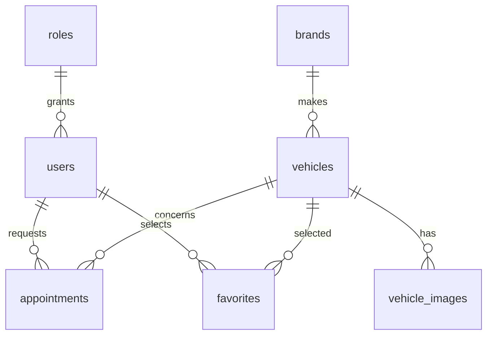

# APEX MOTORS — Phase 3.1 Database Foundation

Verification dates: 21–22 October 2026 (Asia/Saigon).

**Status: implementation delivered; Phase 3.1 acceptance remains incomplete until the real MySQL 8.4 integration suite passes.** H2 and default-profile success do not establish MySQL compatibility.

## Scope and repository safety

- Actual checkout: `C:\Users\long5\Downloads\APPEX_MOTOR_PHASE2`.
- Remote: `https://github.com/dragon23052005/APPEX_MOTOR.git`.
- Starting branch: `phase-2-cinematic-showroom`, HEAD `ab002a8`.
- Working branch created: `phase-3-database-foundation`.
- No local `main` branch existed. The local `origin/main` reference lacked commit `ab002a8`'s image cache fixes, Maven Wrapper, Java/Maven checks and portable IntelliJ configuration. To preserve Phase 2, the new branch was created from the current checkout instead of reverting those files to `origin/main`. No merge, reset or clean was performed. On 22 October 2026, the user explicitly authorized committing and pushing the Phase 3.1 branch to GitHub.
- `mvnw.cmd` was read and left untouched. Its SHA-256 remains `46EEDB8419BD14FE70D5BB2916D7B6F51806E51B39D5B76A42610384CA929C1C`. There was no tracked wrapper modification at the initial inspection.
- Existing untracked local content was not edited by this task. The existing controllers, services, view models, catalog repositories, tests, templates, static assets and Ferrari manifest were not changed.
- An unrelated addition of two blank lines to `tools/prepare_ferrari_gallery.py` appeared during the session. It was left intact and is not part of the database implementation.
- No existing database or Docker volume was deleted or reset. Database constraint/deletion tests operate only in isolated test databases and roll back their data changes.

## Implemented features

1. Spring Boot-managed JPA, MySQL Connector/J, Flyway Core and Flyway MySQL dependencies. H2 and Testcontainers are test-scoped. Java 21, Spring Boot 3.5.7 and every existing dependency/plugin are preserved.
2. MySQL 8.4 Compose service for `demotesting`, authenticated health check, restart policy, persistent named volume, UTF8MB4/collation, UTC and configurable loopback-only host port.
3. `.env.example` with placeholders, ignored local `.env` with independently generated random passwords, and secret-bearing file ignore rules. No real credentials are included in tracked source or this report.
4. Explicit `mysql` profile with DataSource, JPA, entity/repository scans, Flyway and `ddl-auto=validate`. Default and `dev` retain the database-free showroom. `dev,mysql` can combine both modes.
5. Two versioned Flyway migrations; no automatic baseline, clean, Hibernate schema generation or destructive recovery logic.
6. Seven JPA entities and seven repositories, lazy unidirectional associations, decimal monetary/specification values, enum strings, bean validation, UTC lifecycle timestamps, composite favorite identity and no cascading JPA removes.
7. Internal startup verifier for connectivity, applied migrations and expected tables/history. No public diagnostic endpoint.
8. Exact seed snapshot from the current eight-vehicle catalog; two roles and eight hero metadata records. No user accounts, invented specifications, binary images or Ferrari manifest duplication.
9. H2, entity-validation, profile-isolation, migration-safety and real MySQL integration tests. Existing Phase 2 regression tests remain unchanged.
10. README setup/migration/troubleshooting documentation and an optional shared MySQL IntelliJ run configuration.

## Schema and relationships

| Table | Keys, types and integrity |
|---|---|
| `roles` | BIGINT identity PK; unique VARCHAR(32) name constrained to ADMIN/CUSTOMER |
| `users` | BIGINT identity PK; required role FK; unique VARCHAR(254) email; password_hash VARCHAR(255); name/phone/enabled; UTC created/updated DATETIME(6) |
| `brands` | BIGINT identity PK; name; unique slug; nullable description |
| `vehicles` | BIGINT identity PK; required brand FK; unique slug; name/description/year; price DECIMAL(15,2); ISO-style currency code; integer power/speed; acceleration DECIMAL(5,2); status and UTC audit timestamps |
| `vehicle_images` | BIGINT identity PK; required vehicle FK; VARCHAR URL/alt/category; display order and primary flag; unique (vehicle, URL) and (vehicle, order) |
| `appointments` | BIGINT identity PK; required user/vehicle FKs; UTC appointment_at; enum status; optional note; UTC audit timestamps |
| `favorites` | Composite PK (user_id, vehicle_id); required FKs and UTC created_at |



Role/brand deletion is restricted while referenced. Appointment history restricts deletion of its user or vehicle. Image metadata cascades on vehicle deletion; favorites cascade on user/vehicle deletion. Foreign keys and ordered lookups are indexed, including appointment user/time, vehicle/time and status/time, and vehicle availability/price.

No bidirectional collection graphs are mapped. Relationships and password hashes are ignored by Jackson, and Hibernate proxy internals are excluded from serialization. Entities are not used by controllers. `UserEntity` normalizes email and validates bcrypt-shaped encoded hashes; no credential hashing/authentication workflow is implemented. Future service operations spanning repositories must define their own transaction boundaries.

Unknown price/specifications can remain null; price and currency must be supplied together. Seed availability is `UNSPECIFIED`, not an assertion about sale inventory. Brand descriptions remain null. Existing extra presentation metadata remains in the unchanged catalog, which continues serving the website even with `mysql` active.

## Catalog seed provenance

Names, slugs, descriptions, years and specifications come directly from `InMemoryVehicleRepository`. EUR comes from both existing price templates.

| Vehicle | Year | EUR price | hp | km/h | 0–100 seconds |
|---|---:|---:|---:|---:|---:|
| Ferrari SF90 Stradale | 2025 | 625000 | 986 | 340 | 2.5 |
| Lamborghini Revuelto | 2025 | 608000 | 1001 | 350 | 2.5 |
| McLaren 750S | 2025 | 324000 | 740 | 332 | 2.8 |
| Porsche 911 GT3 RS | 2025 | 285000 | 518 | 296 | 3.2 |
| Aston Martin Valhalla | 2026 | 850000 | 1064 | 350 | 2.5 |
| Rimac Nevera | 2025 | 2400000 | 1914 | 412 | 1.9 |
| Koenigsegg Jesko Attack | 2025 | 3000000 | 1578 | 480 | 2.5 |
| Mercedes-AMG ONE | 2025 | 2720000 | 1049 | 352 | 2.9 |

These remain demonstration values from Phase 2. Versioned seeds are applied once, not upserted at every startup. Regression tests compare all represented fields and hero URLs with the existing source catalog and verify that a repeated Flyway run does not overwrite local edits.

## Files created

- `compose.yaml`, `.env.example`, this report, `.run/APEX MOTORS MySQL.run.xml`.
- Local-only ignored `.env`; ignored `target/phase3-*` execution logs and packaged-startup check script.
- `src/main/resources/application-mysql.properties`.
- `src/main/resources/db/migration/V1__database_foundation.sql`.
- `src/main/resources/db/migration/V2__seed_showroom_catalog.sql`.
- `src/main/java/com/apexmotors/persistence/config/MySqlPersistenceConfig.java`.
- `persistence/entity/`: `AuditedEntity`, `RoleEntity`, `UserEntity`, `BrandEntity`, `VehicleEntity`, `VehicleImageEntity`, `AppointmentEntity`, `FavoriteEntity`, `FavoriteId`, `RoleName`, `AvailabilityStatus`, `ImageCategory`, `AppointmentStatus`.
- `persistence/repository/`: `RoleJpaRepository`, `UserJpaRepository`, `BrandJpaRepository`, `VehicleJpaRepository`, `VehicleImageJpaRepository`, `AppointmentJpaRepository`, `FavoriteJpaRepository`.
- `persistence/health/`: `DatabaseHealthVerifier`, `DatabaseStartupCheck`.
- `src/test/java/com/apexmotors/persistence/`: `DatabaseContract`, `H2DatabaseTest`, `MySqlDatabaseIT`, `DefaultProfileIsolationTest`, `DevProfileIsolationTest`, `EntityValidationTest`, `FlywaySafetyTest`.
- `src/test/resources/application-testdb.properties`, `src/test/resources/docker-java.properties`.

## Files modified

- `pom.xml`: managed database/test dependencies and optional Failsafe `mysql-it` profile.
- `src/main/resources/application.properties`: conditional `!mysql` isolation document.
- `.gitignore`: local credentials/configuration/export rules.
- `README.md`: Phase 3.1 architecture, setup, variables, profiles, connection instructions, migrations, IntelliJ, testing and troubleshooting.

## Verification results

| Check | Result and evidence |
|---|---|
| Java 21 / Spring Boot version | Preserved Java 21 and Spring Boot 3.5.7; Maven Wrapper 3.9.16 used |
| Existing Phase 2 regressions | **PASS:** all 26 unchanged Java tests |
| Added isolated Java tests | **PASS:** 14 tests: eight H2 database contract checks, two profile-isolation checks, three entity-validation checks and one Flyway safety check |
| H2 migrations / JPA validation | **PASS:** V1 and V2 applied to a fresh isolated H2 database; `ddl-auto=validate` passed; seven JPA repositories loaded |
| Unknown schema protection | **PASS:** Flyway refused a nonempty schema without history, clean was refused, preexisting test data stayed intact |
| Default / dev isolation | **PASS:** no DataSource, EntityManagerFactory, Flyway or JPA repository beans; in-memory/JSON repositories retained even with H2 on the test classpath |
| JavaScript gallery regressions | **PASS:** `node --test tools/vehicle-gallery.test.cjs`, 11 tests |
| Packaged default startup | **PASS:** executable JAR started with no database infrastructure; `/`, `/collection`, `/about`, `/contact`, Ferrari detail route and all 24 delivery images returned HTTP 200; only its smoke-test process was stopped |
| Compose syntax/interpolation | **PASS:** `docker compose config --quiet`; localhost-only binding verified in source |
| Persistent Compose service startup | **NOT EXECUTED:** no development container or persistent volume was created |
| Real MySQL 8.4 migrations/repositories/server startup | **INCOMPLETE:** `mysql-it` was attempted but failed during container setup, before SQL migrations or integration test methods executed |
| Final default Maven build | **PASS on 22 October:** `mvnw.cmd -B verify -DargLine=-Xmx512m` with `MAVEN_OPTS=-Xmx256m`; 40 tests, zero failures/errors/skips; executable JAR packaged; BUILD SUCCESS |
| Source preservation | `git diff` confirmed existing application models/services/controllers/repositories/templates/static files/manifest and existing tests unchanged; wrapper SHA-256 unchanged |
| Secrets / Git | `.env` is ignored; real credentials excluded from tracked artifacts; branch publication separately authorized by the user on 22 October 2026; unrelated local edits excluded |

Real MySQL verification encountered two environment issues. First, Spring Boot's managed Testcontainers client used an obsolete Docker API default; the test-only `docker-java.properties` setting resolved that connection error. Docker then interrupted the `mysql:8.4` image pull (named pipe ended / image inspection HTTP 500). A subsequent CLI image download was interrupted. On 22 October the Docker Desktop Linux engine was unavailable (named pipe absent). No successful MySQL integration result is claimed.

A new test initially exposed Hibernate proxy internals during serialization. The entity annotations were fixed, and all 40 Java tests subsequently passed. Sandbox restrictions on Maven cache writes, Mockito attachment and Java loopback sockets required approved runs outside the sandbox. A later duplicate build failed from native memory exhaustion; the final retry bounds Maven to 256 MB and the test JVM to 512 MB.

Useful local evidence (all under ignored `target/`): `phase3-tests.log` (26 existing tests), `phase3-full-verify.log` (40 tests and JAR packaging passed before Docker setup failed), `phase3-default-smoke-result.log`, `phase3-final-verify.log`, `surefire-reports/` and `failsafe-reports/`. The failed Failsafe setup report must not be mistaken for passing or skipped MySQL test coverage.

To finish the outstanding acceptance check on a host with sufficient free memory and Docker Desktop running:

```powershell
$env:MAVEN_OPTS = '-Xmx256m'
.\mvnw.cmd verify -Pmysql-it '-DargLine=-Xmx512m'
```

Then start the prepared development environment with `docker compose up -d --wait mysql` and the `mysql` application profile as documented in README. Preserve existing volumes and credentials.

## Known limitations and operational notes

- The website intentionally continues to use the in-memory catalog and Ferrari JSON in every profile. Database-backed page rendering is a later milestone.
- H2 results alone are not proof of MySQL compatibility. Real MySQL tests have a separate Failsafe run and cannot silently skip an unavailable Docker engine.
- Testcontainers uses the Spring Boot-managed version. A test-only `api.version=1.44` setting is required with the current Docker Desktop engine; the integration test requires a compatible Docker API. See the [docker-java configuration documentation](https://github.com/docker-java/docker-java/blob/main/docs/getting_started.md).
- MySQL Compose data persists across restarts. Environment initialization variables do not update passwords already stored in an existing volume. No volume deletion is part of setup or troubleshooting.
- An unknown nonempty schema is deliberately refused. Existing-schema adoption, backups, reviewed baseline decisions and production migration privileges require a separate operational plan; instructions are in README.
- No browser interaction was changed by this phase. Existing MockMvc, asset-delivery and JavaScript state tests cover regressions; a new manual visual audit is not claimed.
- `is_primary` is metadata; a later image-management workflow must enforce its policy for selecting/replacing the primary image. URL and display-order duplicates are already rejected by the database.
- Login, registration, Spring Security, administrator UI, booking flows, payments and carts are not implemented.

## Remaining Phase 3 work

Design a reviewed database-to-showroom adapter and migration of remaining view metadata; add authentication/authorization with secure password encoding; add customer/favorite/appointment services and rules; add protected administrative workflows. These are deliberately outside Phase 3.1 and were not started here.
